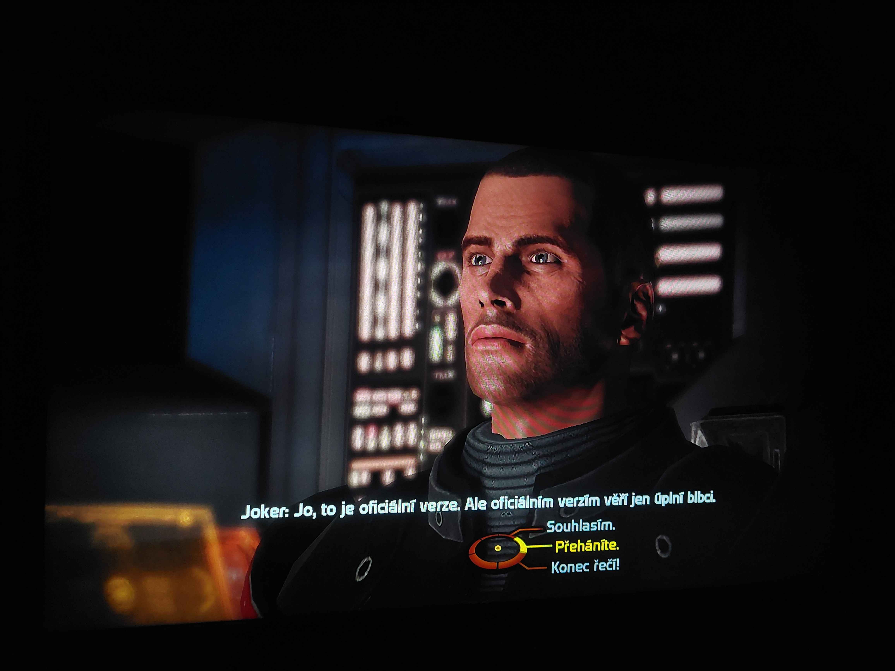
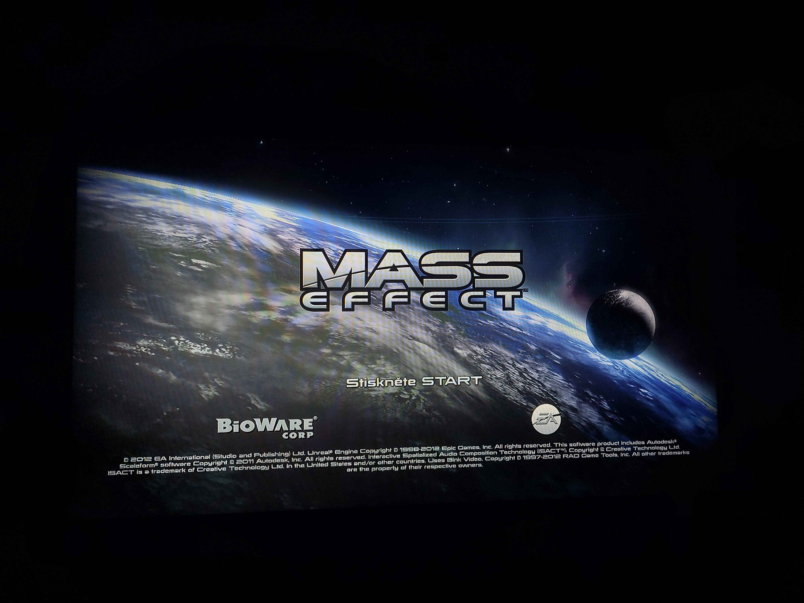
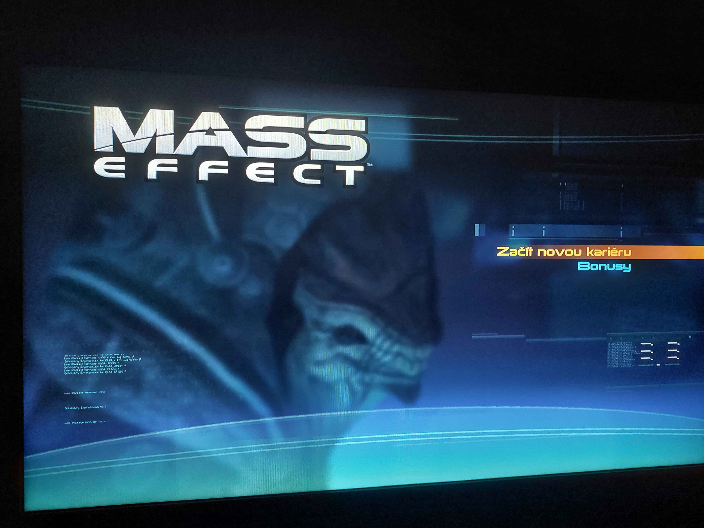

# Mass Effect 1 – Česká lokalizace (PS3)

Neoficiální komunitní projekt zaměřený na technický port české textové lokalizace z PC verze hry **Mass Effect** do verze pro **PlayStation 3**.

Cílem projektu je zpřístupnit české titulky a texty také hráčům evropské PS3 verze hry, a to jak v diskové, tak v digitální variantě.

---

## O projektu

Tento projekt řeší technické přizpůsobení a import existujícího českého překladu z PC verze hry Mass Effect do prostředí konzole PlayStation 3.

**Důležité upozornění:** Nejsem autorem původního českého překladu. Veškeré texty pocházejí z oficiální české PC lokalizace vytvořené společností **CD Projekt Czech** (dnes **Comgad**). Mou prací je pouze úprava formátů, fontů a integrace těchto textů do konkrétních PS3 verzí hry.

## Kompatibilita

| Informace | Hodnota |
|---|---|
| Hra | Mass Effect |
| Platforma | PlayStation 3 / RPCS3 |
| Region | Evropa (PAL) |
| Disková verze | `BLES01774` |
| Digitální verze (PSN) | `NPEB01195` |
| Jazyk | Čeština (texty a titulky) |
| Formát instalace | `.pkg` patch |

**Pozor:** Projekt je určen výhradně pro evropské verze hry s označením `BLES01774` a `NPEB01195`. Kompatibilita s americkou verzí (`BLUS`) nebo jinými regiony není podporována.

Disková a digitální verze mají odlišnou strukturu souborů. Pro každou z nich proto vždy použijte odpovídající instalační balíček.

## Ke stažení a instalace

Aktuální instalační balíčky jsou dostupné v sekci **[Releases](https://github.com/Nwah67/Mass-Effect-1-PS3-Czech-Translation/releases/tag/v1.0.0)**.

Balíčky jsou rozděleny podle verze hry:

- **`ME1_CZ_PS3_DISC.pkg`** – pro evropskou diskovou verzi (`BLES01774`).
- **`ME1_CZ_PS3_DIGITAL.pkg`** – pro evropskou digitální verzi z PlayStation Store (`NPEB01195`).

**Důležité:** Nikdy neinstalujte balíček pro diskovou verzi na verzi digitální a naopak. Podrobný návod na instalaci krok za krokem najdete přímo u stažení v sekci **Releases**.

## Ukázky české lokalizace

Níže naleznete ukázky české lokalizace ze hry Mass Effect pro PlayStation 3.

### České dialogy

### Úvodní obrazovka

### Hlavní menu

## Testování

Lokalizace byla otestována přibližně během první hodiny hraní. Menu, dialogy i herní rozhraní se zobrazují správně v češtině a bez technických problémů.

| Verze hry | Stav testování | Poznámka |
|---|---|---|
| `BLES01774` | Otestováno (úvodní část hry) | Funkční na konzoli PS3 i v emulátoru RPCS3 |
| `NPEB01195` | Otestováno (úvodní část hry) | Funkční na konzoli PS3 i v emulátoru RPCS3 |

Vzhledem k rozsahu hry nebyl zatím otestován kompletní průchod až do konce. V pozdějších fázích hry se proto mohou ojediněle objevit drobné nedostatky, například:

- Neideální zalamování delších řádků textu v některých oknech.
- Drobné textové či formátovací chyby v pozdějších misích a kodexu.

### Nahlášení chyb

Pokud během hraní narazíte na jakoukoli chybu v zobrazení textů nebo technický problém způsobený lokalizací, nahlaste ji prosím v sekci **[Issues](https://github.com/Nwah67/Mass-Effect-1-PS3-Czech-Translation/issues)**.

Do hlášení prosím uveďte:

- Stručný popis chyby a místo ve hře, kde k ní došlo.
- Verzi hry (`BLES01774` nebo `NPEB01195`).
- Platformu (originální konzole PS3 s CFW/HEN, nebo emulátor RPCS3).
- Screenshot obrazovky, pokud je to možné.

## Poděkování

Velké poděkování patří původnímu lokalizačnímu týmu společnosti **CD Projekt Czech** (dnes **Comgad**) za vytvoření oficiálního českého překladu pro PC verzi hry Mass Effect. Bez jejich práce by tento port nemohl vzniknout.

## Právní upozornění

Tento projekt je neoficiální, nekomerční komunitní iniciativou a není nijak spojen se společnostmi Electronic Arts, BioWare, Sony Interactive Entertainment ani Comgad.

Mass Effect, jeho název, ochranné známky a veškerý původní herní obsah náleží příslušným držitelům práv. Autor tohoto projektu si nepřivlastňuje autorství hry ani původní české lokalizace.

Projekt neobsahuje kompletní hru a vyžaduje vlastnictví originální kopie hry.
